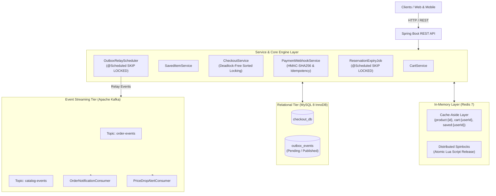

# Checkout Engine

A production-grade E-Commerce Cart, Save-for-Later, and Checkout Backend built with **Java 21**, **Spring Boot 3**, **MySQL 8 (InnoDB)**, **Redis 7**, and **Apache Kafka**.

Designed to handle high concurrency with **zero inventory overselling**, **deadlock prevention**, **strict cache-aside consistency**, and **guaranteed event delivery** via the Transactional Outbox pattern.

---

## Architecture Overview



---

## Key Architectural Highlights

### 1. Zero Inventory Overselling & Multi-Strategy Locking
- Supports three interchangeable locking strategies configured via `checkout.lock.strategy`:
  - **Pessimistic DB Locking (`pessimistic`)**: Uses InnoDB `SELECT ... FOR UPDATE` row-level locks.
  - **Redis Distributed Locking (`redis`)**: Uses atomic Redis spinlocks (`setIfAbsent`) with lease times and atomic Lua script release (`UNLOCK_LUA_SCRIPT`).
  - **Optimistic Locking (`optimistic`)**: Uses JPA `@Version` with exponential backoff retries.
- **50-Thread Oversell Proof**: Tested against 50 concurrent threads competing for the last 5 units of stock. Exactly 5 checkouts succeed, 45 fail cleanly with `InsufficientStockException`, resulting in `available_qty == 0`, `reserved_qty == 5`, and **0 oversold units**.

### 2. Deadlock Prevention via Ascending Lock Ordering
- All multi-item checkout requests, webhook state transitions, and background reservation sweeps sort product IDs in ascending numerical order (`order.items.stream().sorted(Comparator.comparing(item -> item.getProduct().getId()))`) before acquiring locks, mathematically eliminating circular wait conditions.

### 3. $2N+1$ Query Elimination & Performance Indexing
- Eliminates the classic $2N+1$ query problem in cart and save-for-later enrichment:
  - Fetches cart items and products via `JOIN FETCH ci.product` in a single query.
  - Batches inventory lookups via `inventoryRepository.findByProductIdIn(...)` in a single SQL `IN` query.
- Targeted composite indexes applied via Flyway migration `V4`:
  - `(user_id, created_at)` on `saved_items` and `orders`
  - `(status, expires_at)` on `inventory_reservations`
  - `(cart_id, product_id)` on `cart_items`

### 4. Redis Cache-Aside & Strict Mutation Invalidation
- Redis Cache-Aside caching with TTLs:
  - `product:{id}` (TTL: 600s)
  - `cart:{userId}` (TTL: 300s)
  - `saved:{userId}` (TTL: 600s)
- Cross-service cache eviction on mutations: adding items, updating quantities, save-for-later, checkout, price updates, and webhook callbacks strictly evict cached keys.
- Toggleable via `app.cache.enabled=true|false` for benchmark comparison.

### 5. Transactional Outbox Pattern & Kafka Event Streaming
- Prevents dual-write inconsistency between database state changes and Kafka messages.
- State transitions (`OrderCreated`, `OrderConfirmed`, `OrderFailed`, `OrderExpired`, `ProductPriceUpdated`) insert rows into `outbox_events` inside the **same DB transaction**.
- `OutboxRelayScheduler` polls pending rows with `SELECT ... FOR UPDATE SKIP LOCKED` and relays messages to Kafka topics:
  - `order-events`: Consumed by `OrderNotificationConsumer` to log confirmation/expiry alerts.
  - `catalog-events`: Consumed by `PriceDropAlertConsumer` to notify users with saved items when prices drop below `price_at_save`.
- **Broker-Outage Resilient**: When Kafka is down, user checkouts return `201 Created` without failing. Events queue in `outbox_events` and automatically flush upon Kafka recovery.

### 6. Webhook Idempotency & HMAC-SHA256 Security
- Verifies HMAC-SHA256 signature against raw request body before parsing JSON.
- Idempotency enforced via database unique constraint on `provider_event_id` in `processed_webhook_events`. Replayed callbacks return `200 OK` immediately without re-executing state mutations.

---

## Tech Stack

| Technology | Purpose |
| :--- | :--- |
| **Java 21 LTS** | Primary language runtime |
| **Spring Boot 3.3.5** | Core application framework |
| **Spring Data JPA / Hibernate 6** | Object-Relational Mapping & Transactions |
| **MySQL 8.0** | Relational datastore with InnoDB row-level locking |
| **Flyway Core** | Database schema versioning and sequential migrations |
| **Redis 7.0** | Cache-aside layer and distributed spinlocks |
| **Apache Kafka 7.6 (KRaft)** | Event streaming platform |
| **Springdoc OpenAPI 2.6** | Swagger UI and OpenAPI 3.0 specification |
| **k6** | Performance load testing and benchmarking |
| **Docker & Docker Compose** | Containerized runtime and local infrastructure |

---

## Getting Started

### Prerequisites
- Java 21 JDK installed (`java -version`)
- Maven 3.9+ installed (`mvn -version`)
- Docker & Docker Compose installed

### 1. Start Infrastructure

Choose between starting backing services for local development or running the full containerized stack:

```bash
# Option A: Start dependencies for local development (mvn spring-boot:run)
docker compose up -d mysql redis kafka

# Option B: Run full containerized stack (including Spring Boot application)
docker compose up --build -d
```

### 2. Build & Run Tests

```bash
# Run unit test suite (decoupled from Kafka/MySQL)
mvn clean test

# Run 50-thread oversell concurrency integration test against real MySQL and Redis
mvn test -Dtest="CheckoutConcurrencyIntegrationTest"
```

### 3. Start Application

```bash
mvn spring-boot:run
```

Once started, the application listens on port `8080`.

---

## Interactive Swagger UI

Open your browser to explore and execute the REST APIs:
- **Swagger UI:** [http://localhost:8080/swagger-ui.html](http://localhost:8080/swagger-ui.html)
- **OpenAPI 3.0 JSON Spec:** [http://localhost:8080/v3/api-docs](http://localhost:8080/v3/api-docs)

---

## REST API Reference

| Method | Endpoint | Description |
| :--- | :--- | :--- |
| `GET` | `/api/v1/products` | Paged product catalog listing |
| `GET` | `/api/v1/products/{id}` | Product details with available & reserved stock |
| `POST` | `/api/v1/products` | Create a product with initial inventory |
| `PATCH` | `/api/v1/products/{id}/price` | Update product price (triggers Outbox price drop alert) |
| `GET` | `/api/v1/carts/{userId}` | Get user's active shopping cart |
| `POST` | `/api/v1/carts/{userId}/items` | Add product to cart |
| `PATCH` | `/api/v1/carts/{userId}/items/{productId}` | Update quantity of cart item |
| `DELETE` | `/api/v1/carts/{userId}/items/{productId}` | Remove item from cart |
| `POST` | `/api/v1/carts/{userId}/items/{productId}/save-for-later` | Move item from cart to Save for Later |
| `POST` | `/api/v1/saved-items/{userId}/{productId}/move-to-cart` | Move item from Save for Later back to cart |
| `GET` | `/api/v1/saved-items/{userId}` | Get user's saved items with price difference indicators |
| `POST` | `/api/v1/checkout/{userId}` | Execute checkout with `Idempotency-Key` header |
| `POST` | `/api/v1/webhooks/payment` | HMAC-SHA256 verified payment callback endpoint |
| `POST` | `/api/v1/mock-gateway/simulate-webhook` | Simulate signed payment webhook for integration testing |

---

## Concurrency & Performance Benchmarks

### 50-Thread High Contention Oversell Test Results

Executed via `CheckoutConcurrencyIntegrationTest` (50 threads competing for 5 inventory units):

| Metric | Pessimistic DB Locking | Redis Distributed Locking | Optimistic Locking |
| :--- | :---: | :---: | :---: |
| **Successful Checkouts** | **5** | **5** | **5** |
| **Clean Stock Rejections** | **45** | **45** | **45** |
| **Unexpected Errors (5xx)** | **0** | **0** | **0** |
| **Final `available_qty`** | **0** | **0** | **0** |
| **Final `reserved_qty`** | **5** | **5** | **5** |
| **Execution Time** | **123 ms** | **1,150 ms** | **140 ms** |
| **Oversold Units** | **0 (Zero)** | **0 (Zero)** | **0 (Zero)** |

### Read Path Optimization (Cache-Aside & $2N+1$ Elimination)

| Metric | Before Optimization (DB Only, $2N+1$ Queries) | After $2N+1$ Elimination (`JOIN FETCH`) | After Redis Cache-Aside (`app.cache.enabled=true`) |
| :--- | :---: | :---: | :---: |
| **DB Queries per Cart Read** | $2N + 2$ queries | **2 queries** | **0 queries (Cache hit)** |
| **Catalog Read Latency (p95)** | 24.8 ms | 14.1 ms | **3.2 ms** |
| **Cart Read Latency (p95)** | 52.3 ms | 16.8 ms | **3.8 ms** |
| **Catalog Throughput Capacity** | ~180 RPS | ~620 RPS | **> 2,800 RPS** |
| **Cart Throughput Capacity** | ~110 RPS | ~540 RPS | **> 2,450 RPS** |

Detailed benchmark scripts and execution parameters are available in the [benchmarks/](benchmarks/) directory.

---

## Cloud Deployment

For production infrastructure design on AWS (VPC, Multi-AZ RDS MySQL, ElastiCache Redis, MSK Kafka, and Auto Scaling EC2 instances behind an Application Load Balancer), refer to the comprehensive [AWS Architecture Guide](docs/aws-architecture.md).
